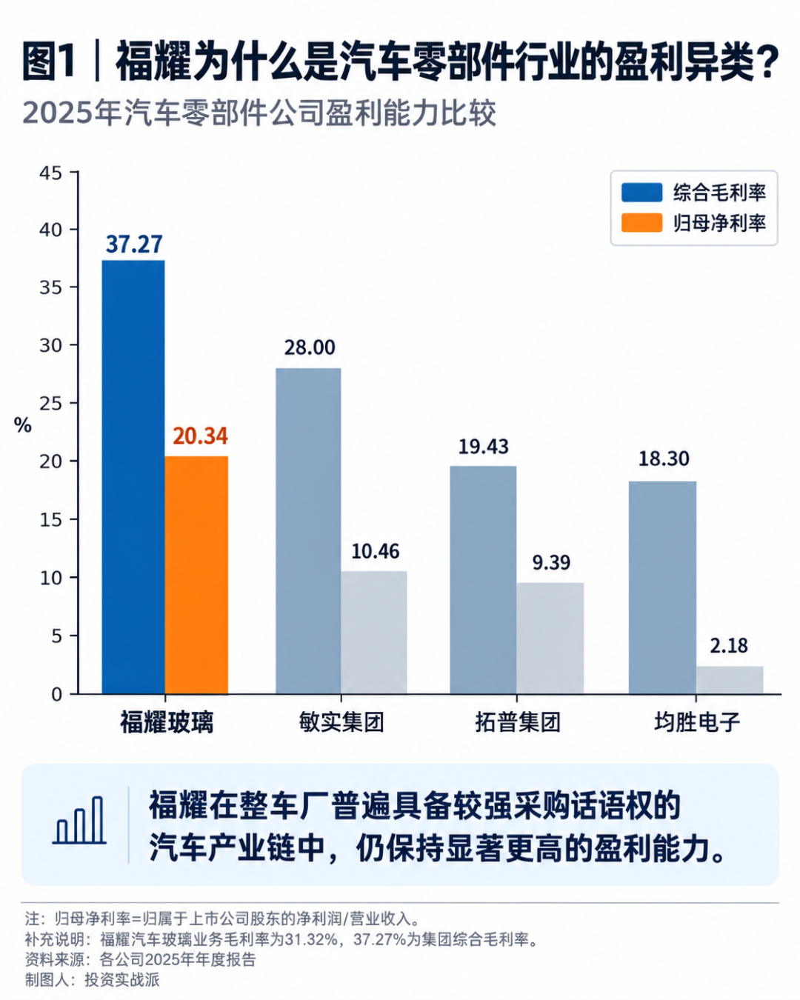
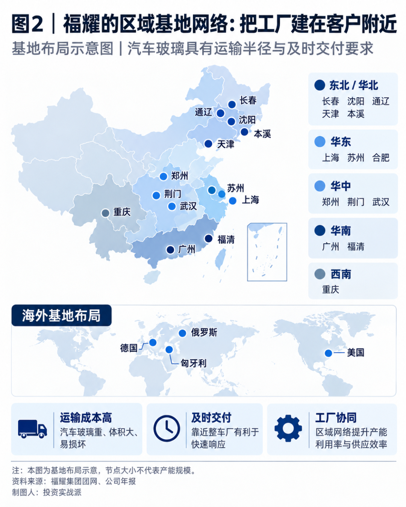
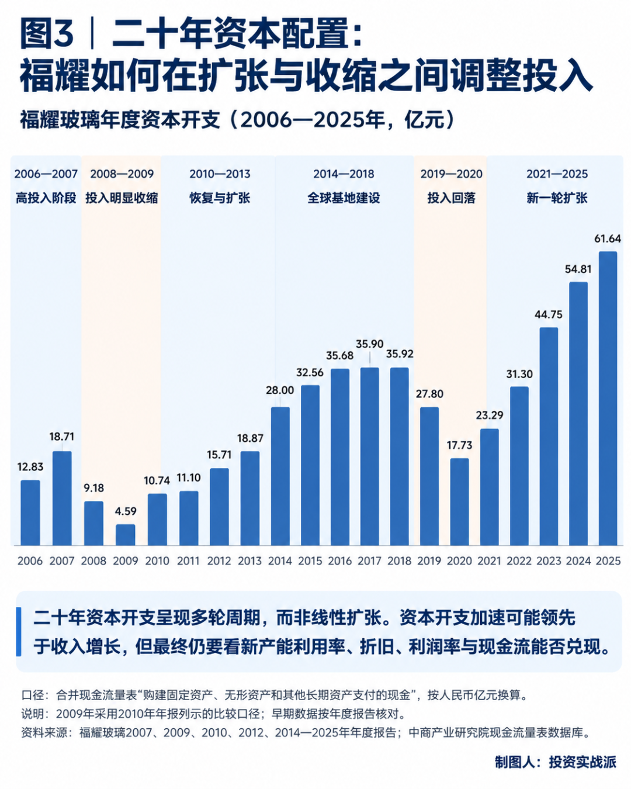
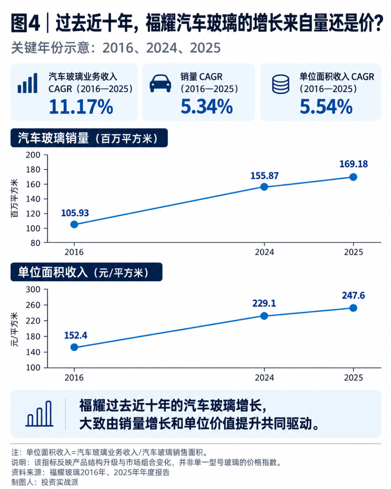
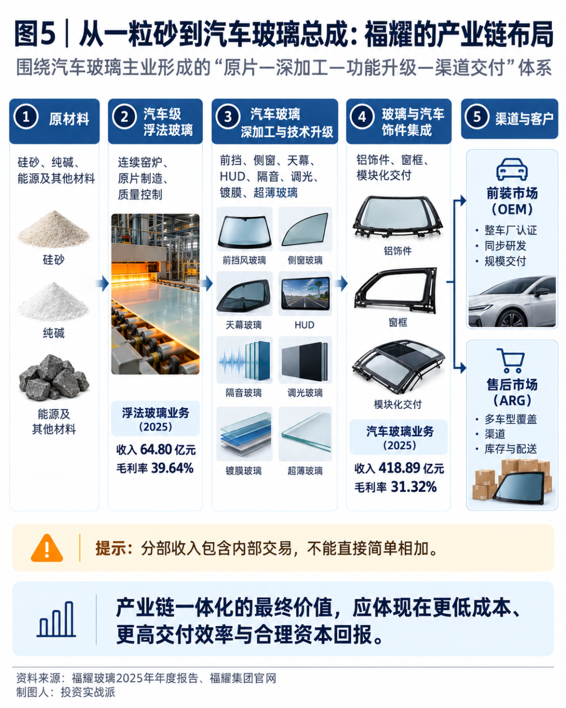
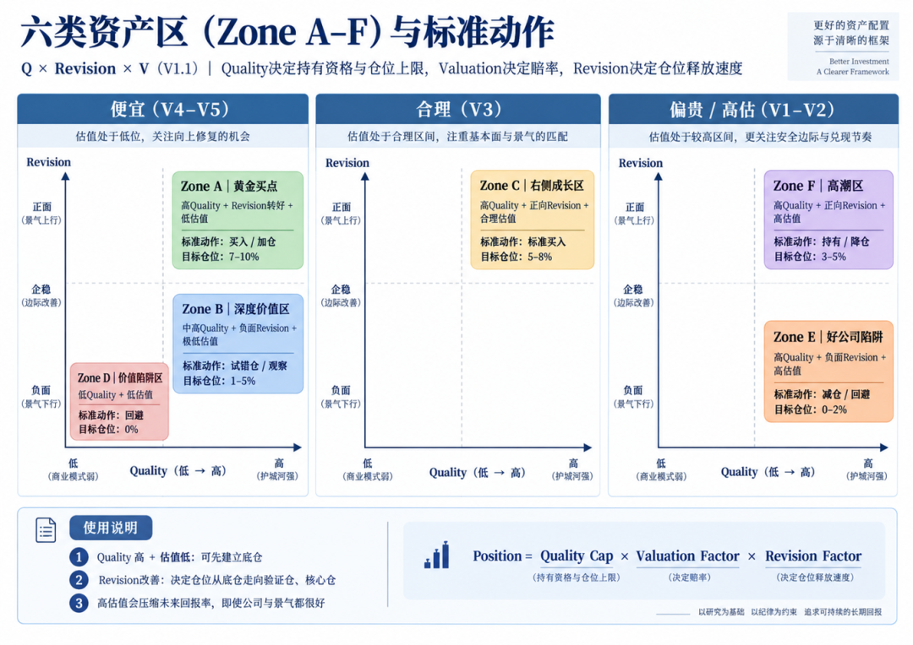

# 福耀玻璃：竞争优势、关键选择和市场关注点 | 1%公司系列

> 公众号：投资实战派
> 作者：王永庆投研
> 发布时间：2026-10-29
> 原文链接：https://mp.weixin.qq.com/s/1FplteiySiOsgiVa5qVPXA?scene=1&click_id=1856683162

---

投资实战派，与1%的公司和伙伴同行

第576 篇原创

本文仅为公司案例研究和复盘，不构成投资建议。

2026年9月，我和朋友 Yan 录制了一期关于福耀玻璃的播客。Yan是投资实战派 Alpha hub的成员，我们一起深入研究了“福耀玻璃“这家公司，这期播客是阶段性总结和思考，分享给大家。

Yan 曾在汽车行业工作七年，其中五年在禾赛科技从事产品相关的工作。汽车零部件行业有一个鲜明特点：整车厂掌握着强势的采购话语权，大部分供应商要面对持续的降价、激烈的竞争以及不断变化的客户需求。在这样一个行业中，能够长期保持较高利润率的企业并不多。

福耀玻璃却是一个有些特殊的存在。2025年，福耀玻璃实现营业收入457.87亿元，归母净利润93.12亿元，集团综合毛利率37.27%，加权平均净资产收益率（ROE）达到25.56%。这些指标放在全球汽车零部件行业中，都值得认真研究。更难得的是，这并非某一年景气周期带来的短暂繁荣，而是一家企业经过数十年积累形成的经营能力。

在我的投资框架中，福耀属于值得长期研究的全球高质量企业。但研究的价值，绝不只是给一家优秀公司贴上“护城河很深”的标签。真正值得追问的是：为什么福耀能够持续赚到竞争对手不容易赚到的钱？它的竞争优势是如何形成的？哪些战略决策真正拉开了差距？以及，对一家已经足够优秀的企业，投资者还能期待什么？

这个问题在当下尤其值得思考。福耀2026年三季报显示，前三季度收入同比增长2.46%，归母净利润同比下降14.97%。汇兑损益是利润变化的重要因素，但剔除汇兑损益影响后，公司利润总额同比也仅增长1.18%。一家长期优秀的公司，正在经历经营增长放缓和资本市场预期变化。理解它过去为什么成功，与判断它未来能否继续成功，以及能否成为一笔好投资，是三个相互关联但并不相同的问题。

# 一、福耀的护城河，究竟来自哪里？

研究一家公司的竞争优势，我习惯先从它所处行业的经济特征入手。因为有些优势来自企业自身的管理能力，有些则是行业天然提供的进入壁垒。如果不能区分这两者，就容易把时代和行业赋予的机会，全部归功于管理层。

汽车玻璃是一种很有意思的产品。在整车制造成本中，玻璃所占比例并不高，但它覆盖汽车很大一部分表面积。与此同时，玻璃又重、又大、易损坏，运输和仓储成本相对较高。这些特征决定了汽车玻璃与普通汽车零部件存在几处重要差异。

首先，汽车玻璃是一门具有区域竞争特征的生意。

由于体积大、运输损耗风险高、单位价值相对有限，长距离运输会明显侵蚀利润。Yan 在对谈中提到，行业里通常会参考数百公里的经济运输半径。这不是一个固定不变的物理界限，而是运输成本、工厂规模、订单密度与产品价值共同决定的经济边界。

因此，汽车玻璃行业的竞争并不完全是全国性乃至全球性的价格竞争，而是带有明显的区域竞争特征。福耀围绕主要汽车产业集群建设生产基地，逐步形成覆盖国内主要整车生产区域、并向海外延伸的供应网络。这张网络的价值不只是减少运费：当一个区域有足够多的汽车客户，工厂就更容易提高产能利用率、分摊固定成本；区域内的客户密度和交付能力，也会反过来增强获客能力。

对于新进入者而言，这会形成一个相互强化的难题：没有足够多的客户，就难以保持产能利用率；没有本地产能，又很难获得足够多的客户。规模、客户密度和交付效率因此构成了区域性的进入壁垒。

其次，汽车玻璃是一门前期投入较大、连续生产要求很高的生意。

生产汽车玻璃需要先将硅砂、纯碱等原材料加工成浮法玻璃，再经过切割、加热、弯曲、夹层、镀膜等工序，生产成符合不同车型要求的产品。浮法玻璃窑炉需要长期连续运行，不能像普通装配产线一样，在没有订单时随意停产。高固定成本和连续生产的特征，决定了产能利用率对企业利润十分重要。

一个新进入者即使获得某家车企的订单，也不代表它有足够的生意支撑整座工厂。如果开工率不足，折旧、能源、人工与研发等成本会迅速侵蚀利润；如果为了弥补亏损不断低价争取订单，又可能陷入经营上的恶性循环。

第三，汽车玻璃是安全件，客户的选择成本远高于产品采购成本。

汽车玻璃涉及碰撞安全、结构强度、光学性能和长期稳定性。供应商不仅需要经过严格认证，还需要在汽车研发阶段就进入整车厂的供应体系。整车厂通常会从性能、安全、质量、成本和交付等维度评估供应商，而不是只比较一片玻璃的报价。

这里还需要补充一个容易被忽略的门槛：福耀与车企的合作，并不是拿到一个采购订单就结束，而是要针对具体车型提前投入开发资源。播客中提到，不同车型的玻璃曲面、尺寸和结构各不相同，供应商需要进行专门设计、开发，并配置相应的工装夹具。按照他引用的行业经验估算，一个车型型号的相关开发投入可能达到1000万至1500万元；如果一个客户有十个车型型号，累计投入就可能达到上亿元。这个数字属于播客中的行业估算，并非福耀单独披露的审计数据，但它说明了项目开发的经济逻辑。

这些投入通常发生在量产之前，而且未必能在项目初期全部收回。供应商还需要配备研发工程师、样品试制、测试验证、质量体系和客户服务团队。车型越多、客户越分散，需要协调的开发项目就越多。大型供应商可以把研发团队、试制设备和质量体系分摊到更多车型、更多客户和更长的生产周期中；小型玻璃厂即使能生产某一种玻璃，也未必有能力广泛覆盖多家整车厂和大量车型。

这使福耀的壁垒不只是工厂规模，而是同时承接大量车型项目、将前期开发投入转化为长期订单的能力。若一家小厂只拿到一两个车型项目，可能不足以支撑一条产线的经济性；若为了争取更多项目继续投入，又要面对产能爬坡、客户认证和资金占用。对于已经建立规模化研发和制造体系的企业，这些投入可以被更多项目分摊；对新进入者而言，却可能形成一条陡峭的学习曲线。

更重要的是，福耀并非完全依靠更高的销售价格获取利润。

汽车厂商有很强的成本控制能力，即使福耀拥有较高市场份额，也不意味着它可以随意提高价格。整车厂出于供应链安全和成本控制，仍然倾向于保留第二供应商。真正优秀的零部件供应商，应该有能力在相近的产品售价下，以更低的成本实现生产和交付。

假设同样一片符合客户标准的玻璃，竞争对手需要900元成本，而福耀只需要600元。如果两者都卖1000元，前者毛利率只有10%，后者却有40%。这个例子只是示意，但揭示了重要的商业逻辑：福耀的优势不一定表现为客户愿意支付更高的价格，而是同样的价格，它能够比竞争对手赚到更多利润。

背后包括更高的良品率、更低的材料损耗、更好的生产效率、更低的运输成本，以及长期积累的工艺和管理经验。这些因素单独看未必惊人，但相互叠加，就可能形成难以复制的系统性成本优势。福耀的护城河不是某项单一技术，而是行业特征与长期经营能力共同形成的一套系统。

# 二、从普通玻璃厂到全球龙头：几个关键的战略选择

如果说行业特征决定了一家企业有可能建立护城河，那么企业家的关键决策，决定了最终是谁拥有这条护城河。复盘福耀的发展历史，会发现它在多个重要节点上，做出了与普通竞争对手不太一样的选择。

第一个选择，是聚焦。

上世纪90年代，福耀曾经涉足多种业务，并非从一开始就只经营汽车玻璃。曹德旺后来逐步将经营重心集中到汽车玻璃领域，减少其他业务的分散投入。这个选择发生在中国汽车工业即将进入快速发展阶段之前。事后看，聚焦似乎是理所当然的正确决策；但站在当时，一家企业选择放弃其他赚钱机会，把资金、人才和管理精力集中到一个业务上，本身就意味着机会成本。

汽车玻璃需要长期研发、区域建厂、客户认证和持续技改。只有持续把资源投入同一个领域，才能让今天的投入成为未来竞争优势的一部分。

第二个选择，是向上游延伸，建立汽车级浮法玻璃生产能力。

在汽车玻璃发展的早期，福耀需要向国际玻璃厂商采购原片。但上游供应商本身也可能是汽车玻璃领域的竞争者。当福耀希望进入全球整车厂供应体系时，上游原材料的质量认证、供应稳定性与交付能力，都可能成为限制因素。

福耀选择自己建设浮法玻璃能力。浮法玻璃是典型的资本密集型业务，建设窑炉需要大量资金，也增加了资产负担和周期风险。但从长期竞争角度看，它有助于解决原材料供应、质量一致性以及成本控制的问题。真正有价值的产业链一体化，不是把所有环节都自己做，而是解决那些制约核心业务发展的关键问题。

第三个选择，是长期坚持区域扩产，并根据行业和自身产能状况调整资本配置。

汽车玻璃工厂的投资存在提前量：企业需要先判断未来几年的汽车产业布局，再决定建设工厂；等工厂建成、完成客户认证、逐步实现满产，往往已经过去数年。

竞争对手可能选择更加谨慎的投资方式：看到需求起来，才决定扩产；市场不景气时，则尽量延缓资本开支。这种行为在财务纪律上并没有错，但如果每次都等待需求充分确定，也可能错过提前锁定客户和区域产能的机会。长期看似激进的产能投资，有可能成为一种进攻性竞争策略；前提是企业对长期需求的判断基本正确，并且具有足够强的资金实力和成本优势，否则逆周期投资也可能演变成过度扩张。

从二十年历史看，福耀的资本开支并非线性增加，而是经历多轮投入、收缩、恢复与再扩张。更准确的结论不是“福耀始终逆周期扩张”，而是公司会根据行业需求、区域布局、技术升级和项目储备，动态调整资本开支。资本开支本身不是护城河；能否把投入转化为客户订单、产能利用率、利润和现金流，才是资本配置能力的检验。

第四个选择，是在汽车产量增长放缓后，转向产品和生产技术升级。

2017年前后，中国汽车产业告别此前的高速增长。福耀在此后的几年里，投入资源进行产线改造和技术升级。当时新能源汽车尚未迎来后来的快速普及，但汽车厂商对于全景天幕、抬头显示、隔热、隔音等功能性玻璃的需求，已经逐步出现。

高附加值玻璃从客户需求、联合研发、小规模验证、项目定点，到逐步投入产能，需要较长的推进过程。福耀在相关产品上的部分布局早于需求大规模释放；当新能源汽车快速发展时，它已经积累了一部分技术和产能准备。这背后最值得借鉴的，未必是管理层精准预测某一年需求爆发，而是长期围绕客户需求开展研发，在需求尚未形成规模时提前完成技术储备和生产准备。

把这些阶段连起来看，福耀的竞争优势并非来自某一次惊人的战略押注，而是一系列长期决策的积累：聚焦主业、补齐关键环节、提前建设产能、持续改善管理、顺应客户需求进行技术升级。当行业机会真正出现时，这些长期投入才集中体现为经营结果。

# 三、汽车玻璃的增长：销量之外，为什么单价还能持续提升？

研究完护城河和历史，最终仍然要回到财务模型。一家企业的历史再精彩，决定未来投资回报的，依然是未来能够创造多少利润和现金流。由于福耀业务相对专注，它的收入增长可以从汽车玻璃销量和单位价值两个维度展开。

根据2016年和2025年年报，2016年福耀汽车玻璃销量约1.06亿平方米；到2025年，销量增加至约1.69亿平方米。同期，汽车玻璃业务收入从约161.45亿元增长至418.89亿元。用汽车玻璃业务收入除以销售面积，能够得到一个近似的每平方米收入指标：2016年约152元，2025年约248元。

在这九个年度间隔里，销量年复合增长约5.3%，单位面积收入年复合增长约5.5%。也就是说，福耀过去的汽车玻璃业务增长，大致可以理解为销量增长和产品单位价值提升共同驱动。

这是一组很有意思的数据。在中国汽车行业竞争激烈、供应商普遍受到年降压力的情况下，福耀汽车玻璃每平方米收入却持续增长。这并不意味着同一型号的玻璃，每年都可以向整车厂涨价5%以上。这里的增长，更重要的是产品结构发生了变化。

以前汽车玻璃的核心作用，是遮风挡雨、保障安全、提供视野。现在的汽车玻璃，正越来越多地承担隔热、隔音、抬头显示、遮阳调光以及通信集成等功能。普通前挡玻璃升级成抬头显示玻璃，需要满足更加严格的光学要求；普通天窗升级成可调光天幕，需要满足复杂环境下的稳定性要求。即使基础原材料没有发生根本变化，产品的制造难度和客户价值也已经不同。

新能源汽车又进一步推动了这种变化。整车设计更加重视车内空间、外观、智能化体验和制造效率。更大的全景天幕、更薄的玻璃，以及具有附加功能的车窗，都为玻璃供应商创造了新的机会。

在播客讨论中，有一个关于全景天幕的例子让我印象很深。传统机械天窗除了玻璃，还需要滑轨、电机、机械结构、密封件等一整套系统。相比之下，一些采用固定式全景天幕的车型，虽然使用了面积更大、价值更高的玻璃，却减少了部分机械结构与装配环节。对于玻璃供应商而言，单车产品价值可能提高；但对于整车厂而言，整体解决方案的成本反而可能下降。当然，两种方案的功能并不完全相同，消费者对通风、隔热和舒适性的要求也有差异。

这个案例体现了一个重要的商业逻辑：供应商并不一定需要通过提高客户的总成本来实现增长。它可以通过提供更有效率的解决方案，在帮助客户节省成本的同时，获得更大的价值份额。这样的增长，比单纯依靠议价权涨价更具持续性。

不过，作为投资者，也需要关注另一个问题：高附加值玻璃的渗透率终究不可能无限提升。某类产品从10%渗透到40%，带来的增长往往比较显著；从70%渗透到90%，边际增长空间可能就有限了。这意味着，不能简单把过去九年单位面积收入5%以上的复合增长率，直接延续到未来十年。需要进一步拆解不同产品的渗透率、价格差异以及技术演进。

例如，HUD玻璃的渗透率提高是否还有足够空间？普通全景天幕升级到可调光天幕，会增加多少单位价值？如果下一代抬头显示技术改变了传统光学方案，对现有玻璃的技术路线又会产生什么影响？福耀的优势在于持续研发和客户合作，但新技术也可能带来新的竞争者。护城河并不意味着一劳永逸，而是企业能够持续适应变化，并在变化中保持竞争优势。

还有一个与量价增长紧密相关、但容易被忽略的特征：汽车玻璃的当前销售，在一定程度上是两三年前、甚至更早项目决策的结果。整车厂通常需要在量产前较早确定供应商；汽车平台的规划和供应商选择可能提前两到三年，部分欧美车型平台的规划期更长。供应商获得项目定点后，还要经历研发验证、工装准备、产线配置、量产爬坡，才会逐步形成实际收入。

这意味着，福耀当期交付的玻璃，并不完全取决于当季才发生的销售谈判，而与此前已经获得的车型项目、车型生命周期和整车厂排产密切相关。对于已经进入量产阶段、且供应份额相对稳定的项目，供应商往往能够根据车型规划和客户排产，对一段时间内的需求形成一定预判。这种提前量提高了业务的可见度，也让长期研发投入与后续订单之间建立了联系。

但可预测性并不等于确定性。汽车车型可能出现上市初期销量脉冲、后续迅速回落，也可能因为市场需求、客户排产或竞争格局变化而低于预期。供应商若先为项目投入开发和产能，却未能获得预期销量，就会面对固定成本、产能利用率和现金回收压力。因此，研究福耀不能只看项目定点数量，还要跟踪车型实际销量、项目生命周期、单车玻璃价值、供应份额以及产能爬坡进度。

# 四、长期竞争优势，是一家企业不断作出的选择

谈福耀的竞争优势，不能只看行业门槛和规模，还应该讨论它为什么能够持续保持经营效率。这里我想强调两点：持续改善的组织能力，以及资本配置的纪律。

在制造业中，很多技术进步并不以惊人的科学突破形式出现。它可能只是某一道工序提高了几个百分点的良品率，某种材料的损耗降低了一点，某个工厂的库存周转更快，或者原本需要人工处理的问题变成了自动化流程。单次改善看起来微不足道，但对于每年生产上亿平方米汽车玻璃的企业，微小的单位成本差异可以积累成巨大的利润差异。

Yan 在研究福耀时，特别注意到企业较早对生产流程进行数字化改造，并持续推进精益管理。我认为，这类管理能力有时比某项专利更难模仿。专利可以有期限，设备可以买到，工程师也可能流动。但一种能够让大量员工持续发现问题、改善工艺、降低成本的组织文化，需要多年时间才能建立。

不过，从投资研究角度，这种能力最终还需要体现在数字上。最重要的不是企业宣传了多少改善案例，而是长期良品率、单位能耗、生产效率、库存周转及资本回报能否持续优于同行。

除了内部改善，福耀也在向汽车玻璃总成业务延伸。例如，通过收购德国SAM等资产，福耀进入汽车铝饰件及相关集成业务。从客户视角看，整车厂希望减少供应商接口，提高总成化交付效率。玻璃与饰件协同供货，有可能减少采购、质量管理及装配成本。但从福耀视角看，这又涉及进入一个与玻璃不同的制造领域。

这部分业务是否能够获得接近玻璃主业的资本回报，仍然需要时间验证。战略协同不等于财务协同。即使一项业务能够提升客户黏性，如果需要投入大量资本，最终只能产生较低利润率和资本回报，也可能稀释整个集团的投资价值。所以，对于产业链延伸，我更倾向于把它视为一个需要持续验证的战略选项，而不是天然的增长红利。

同样，对于海外扩张，也不能只看到福耀竞争对手在部分市场面临困难，就认定市场会自然转移到福耀手中。全球汽车玻璃行业仍然有AGC、NSG、圣戈班旗下Sekurit等有实力的竞争者。圣戈班曾研究汽车玻璃业务的潜在出售，但不能据此认定它已经退出该市场。海外经营涉及能源、人工、税收、贸易政策、汇率以及当地供应链等复杂因素。一项本土化投资，只有在投产、爬坡和客户订单兑现之后，才会真正体现为经济利润。

福耀历史上的成功资本配置，可以增强我们对管理层的信任，但不能替代对每一个新项目经济回报的分析。公司已在2025年完成董事长职务交接，由曹晖担任董事长，曹德旺继续担任董事及终身荣誉董事长。长期而言，我们仍然需要关注：过去几十年形成的专注、成本纪律、客户导向和长期资本配置能力，能否在代际传承之后继续保持？这比单纯判断接班人履历更有价值。

# 五、市场担心的是什么？高质量公司也可能进入经营低增长阶段

一家公司的历史竞争优势再强，也不能成为忽视当前经营变化的理由。福耀2026年三季报显示，前三季度公司收入341.23亿元，同比增长2.46%；归母净利润60.06亿元，同比下降14.97%。公司披露，前三季度发生约10.67亿元汇兑损失，而上年同期是约4.81亿元汇兑收益。两期汇兑损益的差额接近15.48亿元，是利润变化的重要解释因素。剔除汇兑损益影响后，前三季度利润总额同比增长1.18%。

因此，仅仅根据归母净利润下降约15%，就判断福耀的核心竞争力受到严重冲击，显然过于简单。但反过来，即使剔除了汇兑影响，利润总额增长也只有约1%，我们同样不应该直接得出公司经营一切正常、增长能力丝毫没有变化的结论。

第一个问题，是过去的高增长能否延续。2025年公司收入增长16.65%，但2026年前三季度收入增长明显放缓。这里既可能有行业需求、汇率折算和项目节奏的影响，也可能反映了前期高附加值产品增长的高基数。需要继续拆解销量、单位价值、区域结构和新项目贡献，而不能把汇兑损益作为所有增长放缓的解释。

第二个问题，是高附加值玻璃的渗透率和单位价值增长空间。2026年上半年，公司披露高附加值产品占比较上年同期提高8.03个百分点。但高附加值产品占比持续提升，不必然意味着未来平均售价增速一定能维持历史水平。还需要考虑不同产品的价值差异、车型销量、客户议价以及新技术替代。

第三个问题，是新一轮产能投资的回报。汽车玻璃是资本密集型行业。产能建成之前，企业首先付出现金；建成之后，折旧开始进入报表，但收入和利润并不一定同步兑现。投资者需要判断新产能何时投产、何时达到合理利用率、是否带来新增市场份额，以及整个项目的投资资本回报率。2026年前三季度经营活动现金流净额同比下降，也提醒我们在观察利润之外，还需要观察营运资本和资本开支。

如果未来收入增长逐步兑现，而扩张性资本开支进入下降阶段，自由现金流可能改善；但如果产能释放不及预期，固定成本和折旧压力也可能持续。资本开支图展示了福耀二十年的投入节奏：资本开支可能领先于收入和利润，但能否转化为回报，仍要看项目兑现。

第四个问题，是供应商竞争和业务边界变化。整车厂始终有引入第二供应商的动力。蓝思科技等企业参与汽车玻璃相关业务，也提醒我们关注产业边界变化。对福耀而言，最重要的未必是有没有新进入者，而是新进入者能否在质量、交付、成本与规模上形成可持续竞争。尤其需要分清，竞争者是在争夺小部分高附加值产品，还是有能力建立覆盖主要汽车产业集群的完整供应体系。

第五个问题，是全球化经营和管理传承。海外市场有潜在增长机会，但也伴随着能源成本、工厂爬坡、贸易政策及汇率波动。不能因为某座工厂采用低碳生产，就简单推论其出口欧洲能够免除所有关税。不同产品适用的贸易规则和碳排放政策，需要分别研究。对一家长期优秀的公司而言，真正值得警惕的往往不是某个季度利润下降，而是竞争优势所依赖的几个关键条件开始发生变化。

# 六、好公司不等于好投资：理解福耀，还需要理解投资周期

对基金经理而言，识别一家优秀公司，只是投资研究的第一步。第二步，是测算企业未来的内在价值。第三步，则是判断当前价格提供了多大的安全边际，以及自己的资金能否承担价值兑现过程中的波动。

在我们的对谈中，我特别强调了一个问题：一家优秀企业的经营周期，未必与投资者的持有周期完全一致。福耀过去的长期增长，并不是以稳定、均匀的方式呈现。它可能提前几年开始投资，经历固定资产增加、利润率阶段性承压、现金流下降，随后随着汽车行业需求变化和新产能利用率提升，才逐步兑现此前的投入。

订单与收入之间的时间差，进一步强化了这一特征。车型项目往往需要提前定点，供应商先投入研发、工装和产线准备，随后才随着车型量产和销售逐步交付。Yan 在播客中提到，从项目定点到量产爬坡、再到利润兑现，汽车零部件行业可能需要三年左右，汽车玻璃项目甚至可能更长。对供应商而言，提前获得的项目为未来一段时间提供了一定需求可见度；对投资者而言，却意味着当前投入、当期利润和未来销量可能并不同步。

这类时间差并非单向利好。它一方面让已经定点的车型项目具备一定可见度，降低了供应商完全依赖当期现货订单的程度；另一方面也让投资回报更依赖车型后续的实际销量。若车型销量不及预期，前期开发投入、产线准备和固定成本可能难以充分摊销。因而，项目定点可以提升预测的基础，但不能替代对车型生命周期、客户排产、供应份额和产能利用率的持续跟踪。

如果是一笔可以持续投资五年以上的资金，那么投资者可以更多关注福耀五年之后的竞争格局、单位价值、合理产能规模以及长期自由现金流。如果是一只需要在两三年内体现相对收益和绝对回报的私募基金，就应该更加关注盈利预期的变化、产能释放的时间、当前估值和股息回报。两者研究的是同一家企业，但买入时点、仓位和持有体验可能完全不同。

在我的投资框架中，需要把三个因素结合起来：Quality（企业质量）× Revision（基本面预期修正）× Valuation（估值）。福耀的长期经营历史，为它的企业质量提供了较为充分的证据。但是否值得在某个时点提高仓位，还需要另外两个条件：公司的经营增长是否正在由放缓转向企稳，或者进入新一轮改善周期？当前股价是否已经充分反映市场对增长放缓、产能投资及海外经营风险的担忧？

因此，对于福耀这样的企业，我会采用几条相对具体的研究和交易原则。

第一，长期跟踪产能利用率和单位经济模型，而不只是汽车行业的产销量。福耀还存在市占率提升、产品结构升级和不同地区产能重新分配的机会。市场总量没有增长，不等于福耀的销量和收入一定不增长。但如果公司产能利用率持续下降、单位制造成本开始恶化，就需要重新评估其竞争优势和盈利预测。

第二，将资本开支分为维持性资本开支和扩张性资本开支。不能简单用净利润加折旧替代经营现金流，也不能把经营现金流全部视为股东可以拿走的钱。企业需要维持窑炉、设备和原有产线，也需要为新增产能、研发及项目开发持续投资。真正决定长期股东回报的，是公司在维持竞争优势和必要增长投入之后，能够持续创造多少自由现金流。

第三，买入价格必须与资金久期相匹配。对于能够等待三五年的资金，可以在估值具备足够安全边际时，承受合理的产能建设和盈利波动。但对于持有期限更短、回撤约束更强的资金，就应该更加重视盈利预期修正，宁可在确认经营改善后支付一定的估值溢价，也不要过早承担过大的时间成本。而在经营尚未企稳、估值也没有明显安全边际的阶段，优秀公司的合理策略可能只是保持研究和适度观察。

第四，投资回报应当拆解为利润增长、股息回报和估值变化。如果未来企业每股利润持续增长，并保持一定分红，那么即使估值不提升，投资者仍可能获得一定回报。但如果买入时估值明显偏高，未来几年的利润增长也可能被估值回落所抵消。不能因为福耀过去实现了较好的长期回报，就直接推断未来几年能够复制。企业可能继续优秀，股票却未必能够持续提供足够高的预期收益率。

# 结语：值得学习的，不只是福耀赚到了多少钱

研究福耀玻璃，让我对制造业有了一个更深的理解。好的制造企业，不一定需要掌握某项独一无二的技术，也不一定拥有对客户的绝对定价权。它可能只是用几十年的时间，在一个看起来普通的生意中，把产品质量、生产效率、供应链管理和资本配置持续做到比同行更好。时间越长，积累的差距就越明显。

福耀过去很多关键决策，也提醒我们：企业家并不是要预测每一个宏观周期，而是在自己的能力范围内，持续做那些有利于长期竞争力的事情。中国汽车产业的快速发展，给福耀提供了巨大的时代机会；但如果没有提前投入、持续改进和全球化能力，它也未必能够成为今天的福耀。这是一种“因缘际会”。

站在投资角度，我们当然希望找到这样的公司。但更重要的是，要分清楚哪些是行业和时代带来的机会，哪些是企业依靠自身能力创造的价值；同时认识到，市场给予的安全边际与我们自身的认知、心力和资金属性，共同决定了最终的投资结果。

我很喜欢这次对谈中关于全景天幕的那个例子。一家企业通过技术和生产效率提升，使自己的产品价值更高，却让客户的整体成本更低。它并非依靠从客户那里拿走更多利益而获得成长，而是通过为客户创造更多价值，建立自己的长期竞争优势。对我而言，这不仅是理解福耀玻璃的一条线索，也是研究优秀企业时非常值得重视的标准。

真正值得长期研究的企业，是那些能够在不断变化的环境中，持续为客户创造价值、提升自身效率，并最终把这些价值转化为股东回报的公司。而作为投资者，我们既要学习这些企业长期积累竞争优势的方法，也要对自己的资金、估值和投资周期保持清醒。好企业值得长期研究，但好投资依然需要安全边际。这两件事，缺一不可。

本文旨在讨论企业竞争优势与投资研究方法，不构成任何证券买卖建议。
